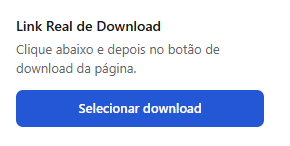

# Link Real de Download

Extensão para Chrome e Edge (Manifest V3) que descobre o link real do arquivo por trás de um botão de download.

## Como usar

1. Abra `chrome://extensions` e ative o modo do desenvolvedor.
2. Clique em "Carregar sem compactação" e escolha esta pasta.
3. Abra a página com o botão, clique no ícone da extensão e em "Selecionar download".
4. Clique no botão de download da página. A extensão mostra os endereços de arquivo observados logo após o clique.

## Permissões

- `activeTab` e `scripting`: injetar o leitor de cliques na aba em que você acionou a extensão.
- `webRequest`: observar as requisições feitas logo após o clique, para achar o endereço do arquivo.
- `downloads`: identificar downloads iniciados pelo navegador.
- `host_permissions: <all_urls>`: o botão pode estar em qualquer site.

Nada é enviado para fora do navegador. Os endereços capturados ficam em memória e são descartados com a sessão.

## Licença

MIT. Veja `LICENSE`.
